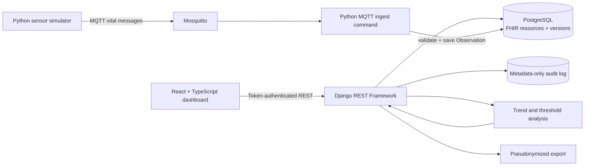
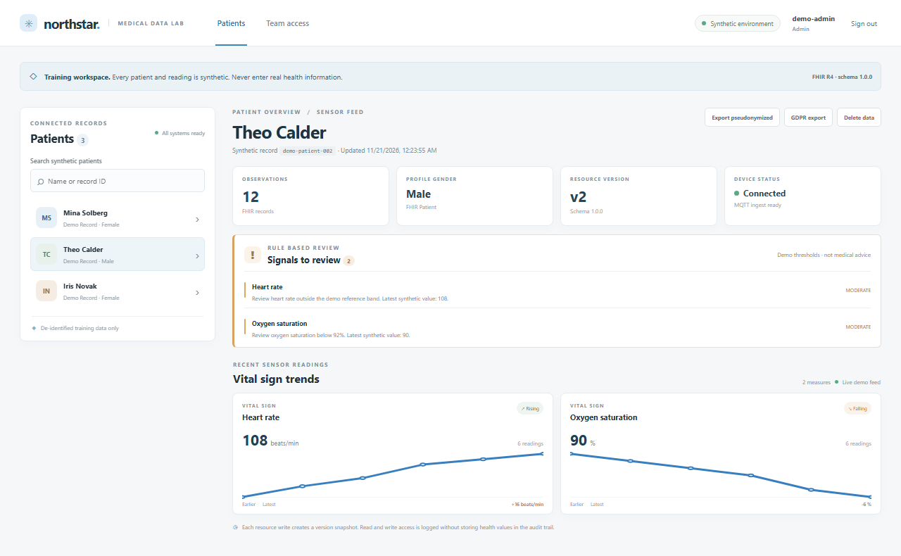
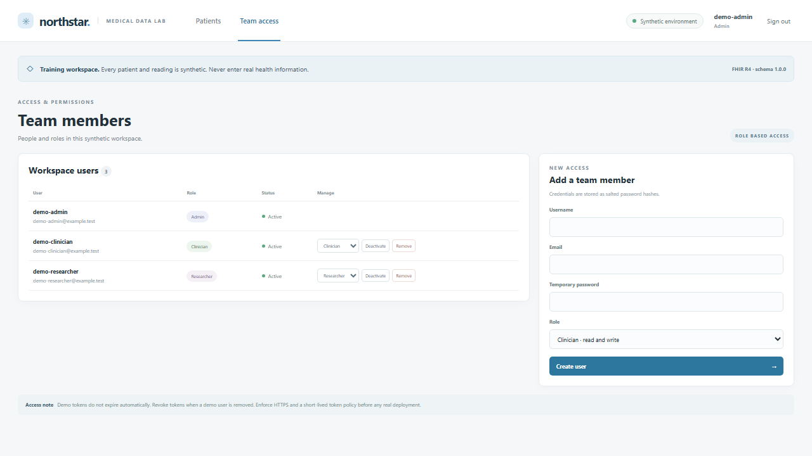

# Medical Data Platform Lab

[](https://github.com/hamza2829/medical-data-platform-lab/actions/workflows/ci.yml)

A small, synthetic-only lab for exploring patient records and vital-sign feeds. It combines a Django REST API, FHIR R4-shaped resources, an MQTT sensor path and a responsive React/TypeScript dashboard. It is a learning and prototyping project, not a clinical system.

> **Synthetic data only.** All names, dates, identifiers, user accounts and readings are invented. Never enter real health or patient information into this repository or a deployment made from it.

## Architecture



## Included workflows

- **Patient workspace:** searchable patient list, FHIR Patient detail, recent vital-sign charts, trend direction and simple threshold alerts.
- **Sensor path:** `scripts/simulate_sensors.py` publishes synthetic heart-rate, oxygen-saturation and temperature messages. The Django `mqtt_ingest` command validates device/patient references, accepted types and ranges before creating FHIR Observation resources.
- **Roles:** seeded `admin`, `clinician` and `researcher` accounts use Django REST Framework token login. Admins manage users. Clinicians can create and update resources. Researchers receive pseudonymized Patient and Observation responses and can download a pseudonymized collection.
- **Privacy operations:** API reads and writes create audit events containing actor, role, route category, action, result and timestamp. Request bodies, patient names, vital values, query strings and network addresses are not copied to the audit table. Clinicians/admins can export an individual record as JSON; admins can permanently remove a Patient and linked Observations.
- **Versioning:** every FHIR resource has a schema version (`1.0.0`) and every write adds an immutable `ResourceVersion` snapshot. Updates increment the FHIR `meta.versionId`.

## Standards and data protection

Resources use FHIR R4 `Patient`, `Observation`, and `Device` resource shapes. Observations use LOINC codes and UCUM units where applicable. The API validates the subset this lab accepts; it is not a certified or fully conformant FHIR server. The versioned profile is in [`schemas/fhir-r4-demo.schema.json`](schemas/fhir-r4-demo.schema.json), and the API contract is [`docs/openapi.yaml`](docs/openapi.yaml).

This repository contains only synthetic records. Researcher-facing resources and exports remove direct identifiers and replace Patient IDs and names with a keyed pseudonym. Pseudonymization is reversible in principle and is not anonymization. The audit trail intentionally stores access metadata rather than clinical content. The GDPR export/delete endpoints demonstrate workflow mechanics; they do not certify legal compliance, retention policy, or identity verification. Demo token authentication is non-expiring and the seeded credentials are public. Use TLS, rotate secrets, replace demo users and establish a short-lived token lifecycle before any real deployment. Do not deploy this lab with real patient data.

## Run the demo

The repository includes PostgreSQL, Mosquitto, the Django API, and the MQTT consumer in Compose. No paid account or API key is needed.

```bash
docker compose up --build
```

Open <http://localhost:8000>. The demo users are:

| Role | Username | Password |
| --- | --- | --- |
| Admin | `demo-admin` | `DemoAdmin2026!` |
| Clinician | `demo-clinician` | `DemoClinical2026!` |
| Researcher | `demo-researcher` | `DemoResearch2026!` |

These credentials are intentionally public and for local synthetic demos only. To publish sensor examples while Compose is running:

```bash
docker compose run --rm app python /app/scripts/simulate_sensors.py --host mqtt --count 10
```

`/api/health/` reports service status, FHIR release and the data schema version. The complete endpoint list and token header format are in the OpenAPI file.

## Tests and CI

GitHub Actions runs Django checks, migration drift checks, pytest against a PostgreSQL service, Vitest, Playwright against the main patient and admin flows, and a Docker Compose build/start/health smoke test. The workflow also starts Mosquitto as a service container for the MQTT-backed job environment. Browser screenshots and the HTML report are uploaded as the `playwright-screenshots-and-report` artifact on every run.

```bash
# API tests (run from server/ after installing requirements-dev.txt)
python -m pytest -q

# Frontend unit tests and production build (run from web/ after npm ci)
npm test
npm run build

# Browser flow (requires API, PostgreSQL and seeded demo users)
npm run test:e2e
```

## Project layout

```text
server/       Django project, API, FHIR schema validation, MQTT ingest and pytest suite
web/          React + TypeScript dashboard, Vitest components and Playwright flows
schemas/      Versioned FHIR R4 subset accepted by the demo
docs/         OpenAPI description and standards notes
infra/        Demo Mosquitto listener configuration
scripts/      Synthetic MQTT publisher
```

## Screenshots

Generated by the Playwright browser flow using seeded fictional records:





## Limitations

- This is an educational prototype, not a medical device, EHR, FHIR certification suite or GDPR compliance package.
- Threshold alerts are fixed demo rules and must not be used for diagnosis, triage or clinical decisions.
- Demo MQTT permits anonymous messages within the Compose network; do not expose the broker publicly.
- API tokens do not expire automatically. Secret rotation, token expiry, stronger identity proofing, rate limits at a gateway, encryption at rest, formal retention controls and security review are deployment responsibilities.
- The data profile intentionally covers only a narrow subset of FHIR R4. Validate integrations against the destination system's implementation guide before use.
